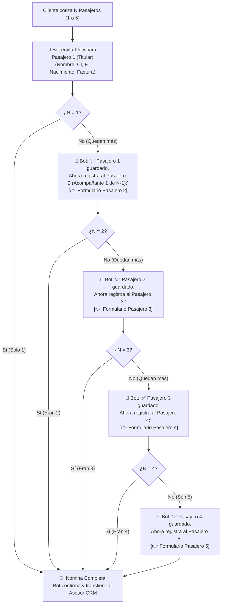

# ✈️ Plan de Implementación: Registro Dinámico de Pasajeros Guiado por el Bot (1 a 5 PAX)

**Fecha:** 05 de Octubre de 2026  
**Sistema:** TAMep WhatsApp CRM & Chatbot Comercial (Laravel 11 + Vue 3 + Meta Cloud API v20.0 + Flows v7.3)  
**Estado:** 🟡 Diseñado y Documentado (Listo para programar y activar esta noche)

---

## 📌 1. Contexto y Justificación Técnica

### A. La Limitación de Meta Flows Estáticos
En WhatsApp Flows, un formulario con pantallas fijas (Opción 2) es rígido:
* Si se programan 5 pantallas fijas de pasajeros, un usuario individual que viaja solo tendría que presionar *"Siguiente"* 5 veces por pantallas vacías para poder llegar a la confirmación, generando fricción y abandono.
* Si viaja un grupo de 6 o más personas, el formulario queda corto y no puede crear pantallas adicionales sobre la marcha.

### B. La Solución: El Bot como Orquestador Dinámico (Opción 1)
El **Chatbot Engine** ya conoce exactamente cuántos boletos se cotizaron en el paso previo ($N$ pasajeros). Por tanto, el bot actúa como un orquestador inteligente que guía al cliente enviando el formulario interactivo **pasajero por pasajero de forma consecutiva**:
* **Si $N = 1$:** Envía 1 formulario ➔ Confirma y entrega al asesor en 20 segundos.
* **Si $N = 2$:** Envía Formulario Pasajero 1 (Titular) ➔ Al recibirlo, envía Formulario Pasajero 2 (Acompañante) ➔ Consolida y entrega.
* **Si $N = 3, 4 \text{ o } 5$:** Va solicitando consecutivamente cada pasajero hasta completar el total requerido.

---

## 🔄 2. Diagrama de Flujo y Casos de Uso (Situaciones 1 a 5)

---

## 💬 3. Detalle de Mensajes y Experiencia del Cliente

### Situación 1: Compra para 1 Pasajero (Titular)
1. **Bot:**  
   > *"📋 Para emitir tu boleto en el vuelo **TM-204 (La Paz ➔ Santa Cruz)**, por favor completa tus datos oficiales 👇"*  
   > `[👉 Registrar Pasajero (Titular)]`
2. **Cliente:** Abre el formulario de 1 pantalla, llena:
   * Nombres y Apellidos.
   * Fecha de Nacimiento (mediante calendario interactivo `DatePicker`).
   * Cédula de Identidad o Pasaporte.
   * Teléfono y Correo.
   * Datos de Factura (NIT / Razón Social - Opcional).
   * Acepta Términos y Privacidad y presiona **Confirmar**.
3. **Bot:** Confirma la recepción y transfiere inmediatamente a un asesor humano en el CRM (`AGENT_HANDOFF`).

---

### Situación 2: Compra para 2 Pasajeros (Titular + 1 Acompañante)
1. **Paso 1:** Envía el formulario para el Pasajero 1 (Titular).
2. **Paso 2:** Al recibir el Pasajero 1, el bot responde de inmediato:  
   > *"✅ **¡Pasajero 1 registrado con éxito!** (Juan Pérez - CI 1234567 LP).*  
   > *Has solicitado boletos para **2 pasajeros**.*  
   > *Por favor registra los datos de tu acompañante:*  
   > 👤 **Pasajero 2 (Acompañante 1 de 1)** 👇"*  
   > `[👉 Registrar Pasajero 2]`
3. **Paso 3:** El cliente completa los datos de su acompañante (Nombre, CI, Fecha de Nacimiento).
4. **Paso 4:** El bot consolida la nómina de los 2 pasajeros y entrega la atención al asesor comercial.

---

### Situaciones 3, 4 y 5: Grupos Familiares o Delegaciones
* El bot lleva el contador exacto en cada interacción:
  * *"Pasajero 2 (Acompañante 1 de 4)"*
  * *"Pasajero 3 (Acompañante 2 de 4)"*
  * *"Pasajero 4 (Acompañante 3 de 4)"*
  * *"Pasajero 5 (Acompañante 4 de 4)"*
* Cada pantalla en el teléfono móvil es **ultra-rápida, limpia y sin scroll**.
* Al recibir el último pasajero ($N$), el bot envía el resumen oficial consolidado:
  > *"🎉 **¡NÓMINA DE LOS 5 PASAJEROS COMPLETADA CON ÉXITO!**  
  > Hemos recibido la documentación oficial para el vuelo **TM-204**:  
  > 1️⃣ Juan Pérez Gómez (Titular) - CI 1234567 LP [F. Nac: 15/08/1990]  
  > 2️⃣ Ana Gómez Soto - CI 2345678 SC [F. Nac: 20/03/1992]  
  > 3️⃣ Pedro Pérez Gómez - CI 3456789 LP [F. Nac: 11/05/2015]  
  > 4️⃣ Luis Pérez Gómez - CI 4567890 CB [F. Nac: 18/09/2018]  
  > 5️⃣ Carlos Pérez Gómez - CI 5678901 LP [F. Nac: 04/02/2021]  
  > 🧾 **Factura:** 1028475021 - Minera San Cristóbal S.A.  
  > 
  > Un asesor de TAMep está revisando tu reserva para emitir tus boletos aéreos. ¡En breves momentos se comunicará contigo! ✈️🎫"*

---

## 🛠️ 4. Componentes Técnicos y Archivos Involucrados

| Componente | Archivo | Rol en la Solución |
| :--- | :--- | :--- |
| **WhatsApp Flow Individual** | [`resources/flows/opcion1_passenger_individual_flow.json`](file:///c:/laragon/www/CRM%20WHATSAPP/resources/flows/opcion1_passenger_individual_flow.json) | Esquema oficial de Meta v7.3 para capturar 1 pasajero a la vez con `DatePicker`, CI, contacto y factura. *(Validado al 100% en Meta Cloud API).* |
| **Motor del Chatbot** | [`app/Services/ChatbotEngineService.php`](file:///c:/laragon/www/CRM%20WHATSAPP/app/Services/ChatbotEngineService.php) | Máquina de estados que evalúa `$passengersCount`, almacena la nómina en `$session['companions']`, orquesta el envío consecutivo del siguiente formulario y activa `AGENT_HANDOFF`. |
| **Controlador de Webhooks** | [`app/Http/Controllers/Webhooks/MetaWebhookController.php`](file:///c:/laragon/www/CRM%20WHATSAPP/app/Http/Controllers/Webhooks/MetaWebhookController.php) | Procesa la respuesta interactiva `nfm_reply` de cada formulario y formatea los datos en el historial del chat del CRM. |
| **Panel Lateral CRM** | [`resources/js/components/booking/TicketBookingPanel.vue`](file:///c:/laragon/www/CRM%20WHATSAPP/resources/js/components/booking/TicketBookingPanel.vue) | Muestra el contador de $N$ pasajeros, el desglose de titular y acompañantes con sus fechas de nacimiento y datos de factura, y el botón **"Copiar Nómina"** en 1 clic. |

---

## 📋 5. Tareas Pendientes para Esta Noche (Checklist de Reanudación)

- [ ] **1. Conexión de Estado en `ChatbotEngineService.php`:**
  - Al procesar `nfm_reply` del Titular:
    - Guardar datos del Titular en `$session['passenger_titular']`.
    - Si `$passengersCount > 1`, establecer estado `$conv->current_state = 'COLLECTING_PASSENGERS_FLOW'`.
    - Despachar automáticamente el Flow para el Pasajero 2.
- [ ] **2. Manejador de Acompañantes Consecutivos:**
  - Al recibir `nfm_reply` de un acompañante:
    - Agregar a `$session['companions'][] = $companionData`.
    - Incrementar índice `$currentIndex`.
    - Si faltan acompañantes, despachar Flow para el Pasajero siguiente.
    - Si se completaron los $N$ pasajeros, generar el resumen consolidado, actualizar el `Lead` y pasar a `waiting_agent`.
- [ ] **3. Soporte Dual (Flow + Texto Opcional):**
  - Si un usuario prefiere escribir el nombre y CI de un acompañante directamente en el chat en vez de abrir el formulario, el bot lo procesa con el analizador de expresiones regulares sin trabarse.
- [ ] **4. Pruebas Automatizadas:**
  - Ejecutar `phpunit` y simular el ciclo completo de 1, 2 y 5 pasajeros.
