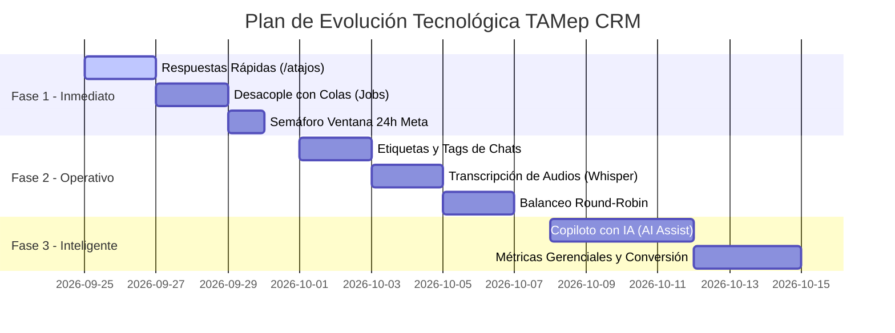

# 🚀 Propuestas de Mejora y Evolución Arquitectónica: TAMep WhatsApp CRM

**Documento:** Propuestas de Mejora Técnica y Funcional  
**Autor:** Antigravity Senior Engineering  
**Fecha:** 22 de Septiembre de 2026  
**Sistema:** TAMep WhatsApp CRM & PWA (Laravel 13 + Vue 3)  
**Objetivo:** Guía estratégica de optimizaciones, nuevas características y blindaje arquitectónico para elevar el CRM a nivel enterprise aerocomercial.

---

## 📌 Índice de Contenidos

1. [Matriz de Priorización y Retorno de Inversión (ROI)](#-matriz-de-priorización)
2. [Fase 1: Productividad Inmediata y Blindaje del Servidor](#-fase-1-productividad-inmediata-y-blindaje-del-servidor)
   - [1.1 Respuestas Rápidas (Canned Responses / Atajos con `/`)](#11-respuestas-rápidas-canned-responses)
   - [1.2 Procesamiento Asíncrono con Colas (Jobs / Queues)](#12-procesamiento-asíncrono-con-colas-jobs--queues)
   - [1.3 Control Visual de la Ventana de 24 Horas de Meta](#13-control-visual-de-la-ventana-de-24-horas-de-meta)
3. [Fase 2: Gestión Comercial y Operativa](#-fase-2-gestión-comercial-y-operativa)
   - [2.1 Etiquetas y Clasificación de Chats (Tags / Labels)](#21-etiquetas-y-clasificación-de-chats-tags)
   - [2.2 Transcripción Automática de Notas de Voz (Speech-to-Text)](#22-transcripción-automática-de-notas-de-voz-speech-to-text)
   - [2.3 Balanceo y Asignación Automática de Chats (Round-Robin)](#23-balanceo-y-asignación-automática-de-chats-round-robin)
4. [Fase 3: Inteligencia Artificial y Métricas Gerenciales](#-fase-3-inteligencia-artificial-y-métricas-gerenciales)
   - [3.1 Copiloto de Respuestas Inteligentes con IA (AI Assist)](#31-copiloto-de-respuestas-inteligentes-con-ia)
   - [3.2 Métricas de Rendimiento en Tiempo Real (Analytics / FRT)](#32-métricas-de-rendimiento-en-tiempo-real)
5. [Hoja de Ruta Recomendada (Roadmap de Implementación)](#-hoja-de-ruta-recomendada)

---

## 📊 Matriz de Priorización

| # | Propuesta | Impacto en el Negocio | Esfuerzo Técnico | Prioridad |
| :-: | :--- | :---: | :---: | :---: |
| **1** | **Respuestas Rápidas (`/atajos`)** | 🟢 Muy Alto (Ahorra horas a los agentes) | 🟢 Bajo (1-2 días) | **P1 - Inmediata** |
| **2** | **Desacople con Colas (Jobs / Queues)** | 🟢 Crítico (Evita duplicados y caídas) | 🟡 Medio (1-2 días) | **P1 - Inmediata** |
| **3** | **Semáforo Ventana 24h Meta** | 🟡 Alto (Evita errores de envío y quejas) | 🟢 Bajo (1 día) | **P1 - Inmediata** |
| **4** | **Etiquetas y Filtros Visuales (Tags)** | 🟡 Alto (Organización y seguimiento de leads) | 🟢 Bajo (1 día) | **P2 - Corto Plazo** |
| **5** | **Transcripción de Audios (Speech-to-Text)** | 🟢 Muy Alto (Lectura rápida de audios) | 🟡 Medio (2 días) | **P2 - Corto Plazo** |
| **6** | **Asignación Automática (Round-Robin)** | 🟡 Alto (Cero demoras en cola de espera) | 🟡 Medio (2 días) | **P2 - Corto Plazo** |
| **7** | **Copiloto de Respuestas con IA** | 🟢 Muy Alto (Asistencia inteligente 24/7) | 🔴 Alto (3-4 días) | **P3 - Mediano Plazo** |
| **8** | **Métricas y KPIs Avanzados de Conversión** | 🟡 Medio (Control gerencial) | 🟡 Medio (2 días) | **P3 - Mediano Plazo** |

---

## 🛠️ Fase 1: Productividad Inmediata y Blindaje del Servidor

### 1.1 Respuestas Rápidas (Canned Responses)
* **El Problema Actual:**  
  Los asesores repiten decenas de veces al día las mismas respuestas: cuentas bancarias para pago por QR, políticas de equipaje, itinerarios semanales y saludos formales. Esto provoca lentitud al tipear y riesgo de errores en números de cuenta.
* **La Solución:**  
  Crear un catálogo de plantillas accesibles mediante el caracter `/` en el campo de texto del chat:
  - `/cuentas`: Inserta datos bancarios oficiales de TAMep (Banco Unión, BCP, QR transferencias).
  - `/equipaje`: Inserta política de equipaje (1 pieza de mano 5 kg + 1 pieza de bodega 20 kg).
  - `/uyuni`, `/rurrenabaque`, `/cobija`: Inserta frecuencias y precios referenciales.
  - `/despedida`: Saludo de cierre formal y encuesta de satisfacción.
* **Beneficio:** Reduce el tiempo de respuesta promedio de 3 minutos a **5 segundos por interacción**.

---

### 1.2 Procesamiento Asíncrono con Colas (Jobs / Queues)
* **El Problema Actual:**  
  Cuando un cliente envía un mensaje por WhatsApp, el webhook de Meta o Evolution entra al controlador y ejecuta de forma síncrona:
  1. Consulta y guardado en MySQL.
  2. Procesamiento del motor del bot.
  3. Notificaciones Web Push (petición HTTPS externa a Google/Microsoft).
  4. WebSockets Pusher.  
  Si la conexión externa tarda más de 5 segundos, **Meta interpreta que el servidor murió** y reenvía el webhook, generando mensajes y notificaciones duplicadas.
* **La Solución:**  
  El webhook responde inmediatamente a Meta con un `HTTP 200 OK` en menos de **50 milisegundos**, y delega el trabajo pesado a Jobs de Laravel (`ProcessWhatsAppWebhookJob`, `SendWebPushJob`).
* **Beneficio:** Servidor blindado contra picos de tráfico, cero cuelgues y cero mensajes duplicados.

---

### 1.3 Control Visual de la Ventana de 24 Horas de Meta
* **El Problema Actual:**  
  Por norma oficial de Meta Cloud API, una empresa solo puede enviar mensajes de texto libre durante las **24 horas posteriores** al último mensaje del usuario. Si un cliente escribió ayer a las 10:00 y el agente intenta responder hoy a las 10:05, Meta rechaza el envío con error `400 Bad Request`.
* **La Solución:**  
  - Incorporar un semáforo visual en la parte superior del chat:
    - 🟢 *Ventana activa: Quedan 18 horas de atención libre.*
    - 🟡 *Atención urgente: Quedan menos de 2 horas.*
    - 🔴 *Ventana expirada (más de 24h).*
  - Si la ventana expiró, el campo de texto se bloquea y se muestra un botón para enviar una **Plantilla HSM Oficial Aprobada** (ej: *"Estimado pasajero, continuamos con su cotización..."*) para reabrir la ventana legalmente.
* **Beneficio:** Evita frustración del agente, errores en consola y pérdidas de clientes por mensajes no entregados.

---

## 📈 Fase 2: Gestión Comercial y Operativa

### 2.1 Etiquetas y Clasificación de Chats (Tags / Labels)
* **El Problema Actual:**  
  Todos los chats aparecen en una lista plana. No es posible distinguir de un vistazo qué cliente tiene una cotización urgente, quién ya pagó o quién tiene un reclamo de vuelo.
* **La Solución:**  
  Sistema de etiquetas multicolores asignables con 1 clic:
  - 🏷️ `Cotización Pendiente` (Azul)
  - 🏷️ `Pago por Verificar` (Amarillo)
  - 🏷️ `Pasaje Emitido` (Verde)
  - 🏷️ `Reclamo / Cancelación` (Rojo)
  - 🏷️ `Cliente Corporativo / VIP` (Morado)
* **Beneficio:** Los supervisores y agentes pueden filtrar la bandeja por etiquetas y priorizar el cierre de ventas de alto valor.

---

### 2.2 Transcripción Automática de Notas de Voz (Speech-to-Text)
* **El Problema Actual:**  
  En Bolivia, una gran cantidad de pasajeros envía notas de voz para consultar vuelos. Si un asesor está atendiendo en mostrador o en llamada telefónica, no puede escuchar audios largos de 1 o 2 minutos.
* **La Solución:**  
  Integrar transcripción mediante IA (ej. OpenAI Whisper API o Gemini Audio API, cuyo costo es de centavos por miles de minutos).  
  Cuando entra un archivo `.ogg` / `.mp3`, el servidor transcribe el audio y lo muestra debajo del reproductor:
  > 🗣️ *"Transcripción: Buenas tardes señorita, quisiera saber si tienen vuelos disponibles para Riberalta el día jueves con retorno el domingo y cuánto sale el pasaje con maleta."*
* **Beneficio:** El asesor lee el mensaje en **3 segundos** sin necesidad de ponerse auriculares ni interrumpir su trabajo.

---

### 2.3 Balanceo y Asignación Automática de Chats (Round-Robin)
* **El Problema Actual:**  
  Cuando un cliente solicita hablar con un humano (`waiting_agent`), el chat queda en la bandeja de espera hasta que algún asesor decide tomarlo manualmente. Si un asesor está distraído o sobrecargado, el cliente espera demasiado tiempo.
* **La Solución:**  
  Algoritmo de reparto equitativo:
  1. El sistema identifica cuáles asesores están con sesión activa (`online`) en ese momento.
  2. Asigna automáticamente el nuevo chat al asesor que tenga **menor cantidad de conversaciones activas**.
  3. Envía una notificación Web Push directa a ese asesor con sonido prioritario.
* **Beneficio:** Distribución justa de la carga laboral y reducción drástica del tiempo de espera del cliente.

---

## 🤖 Fase 3: Inteligencia Artificial y Métricas Gerenciales

### 3.1 Copiloto de Respuestas Inteligentes con IA (AI Assist)
* **El Problema Actual:**  
  El bot actual se rige por árboles de decisión numéricos (1, 2, 3). Preguntas abiertas sobre equipaje especial (mascotas en cabina, instrumentos musicales, niños no acompañados) requieren intervención humana completa.
* **La Solución:**  
  Un botón integrado en el chat: **"✨ Sugerir Respuesta con IA"**:
  - La IA analiza la duda del pasajero contra el reglamento oficial de TAMep.
  - Redacta una respuesta amable, precisa y con el formato corporativo de la aerolínea.
  - El asesor solo hace clic en *"Aprobar y Enviar"* o ajusta una palabra antes de enviar.
* **Beneficio:** Un asesor nuevo puede responder con la precisión de un experto desde su primer día de trabajo.

---

### 3.2 Métricas de Rendimiento en Tiempo Real (Analytics / FRT)
* **Indicadores Clave para el Administrador:**
  - **FRT (First Response Time):** Tiempo exacto en minutos que tardan los asesores en dar la primera respuesta a un pasajero.
  - **Tasa de Conversión:** Cuántas conversaciones terminan en emisión de boleto exitoso.
  - **Mapa de Calor Horario:** Gráfica de horas y días con mayor tráfico de WhatsApp para coordinar turnos del personal.
  - **Rendimiento por Agente:** Cantidad de boletos emitidos y chats cerrados por cada miembro del equipo.

---

## 🗺️ Hoja de Ruta Recomendada (Roadmap de Implementación)

---

## 📋 Conclusión del Análisis Senior

El CRM cuenta con una base arquitectónica sólida y moderna:
* Frontend SPA reactivo en Vue 3 con modo PWA y soporte offline.
* WebSockets en milisegundos con Pusher.
* Notificaciones Web Push VAPID a costo cero para despertar computadoras y celulares apagados.
* Motor híbrido de emisión de pasajes y chatbot automatizado.

Implementar la **Fase 1** (Respuestas Rápidas + Colas de Laravel + Semáforo de 24h) consolidará la estabilidad técnica del servidor en cPanel y aumentará inmediatamente la velocidad de ventas de los asesores.
Como desarrollador senior, tras haber analizado a fondo la arquitectura completa de TAMep CRM (Laravel 13, Vue 3 PWA, WebSockets, Webhooks de Meta y Evolution API), he estructurado las mejoras recomendadas clasificadas por prioridad y retorno de inversión (ROI) para el negocio:

🟢 Prioridad 1: Rendimiento y Robustez Técnica (Recomendado a Corto Plazo)
1. Desacoplamiento de Webhooks y Web Push con Jobs (Colas de Laravel)
Situación actual:
Cuando un cliente escribe por WhatsApp, el webhook de Meta o Evolution entra al controlador, procesa el bot, consulta la BD y dispara los Web Push VAPID de forma síncrona en la misma petición HTTP.
Riesgo:
Si la API de Google/Microsoft tarda 500ms en responder el Web Push o si entran 10 mensajes simultáneos, el webhook puede demorar más de 5 segundos. Meta considera esto un timeout y reintenta la petición, provocando mensajes duplicados.
Mejora:
Despachar el procesamiento y los envíos de Web Push a un Job en cola (SendWebPushJob, ProcessWhatsAppWebhookJob). El webhook responderá a Meta en menos de 50 milisegundos (HTTP 200) y el trabajo pesado se ejecuta en segundo plano.
2. Semáforo y Control de la "Ventana de 24 Horas" de Meta
Situación actual:
Por política oficial de WhatsApp Business API, una empresa solo puede responder con mensajes libres durante las 24 horas posteriores al último mensaje del cliente. Si pasan 24 horas y el agente intenta responder, Meta rechaza el mensaje con error 400.
Mejora:
Mostrar un temporizador/semáforo visual en la cabecera del chat (ej. 🟢 Ventana activa: 14h restantes, 🟡 Vence en 1h, 🔴 Ventana cerrada).
Si la ventana caduca, habilitar un selector para enviar una Plantilla Oficial Aprobada de Meta (HSM) para reactivar la conversación legítimamente.
🟡 Prioridad 2: Productividad de los Agentes de Ventas
3. Respuestas Rápidas (Canned Responses / Atajos con /)
Impacto: Alto en tiempo de respuesta del agente.
Mejora:
Permitir que los asesores escriban atajos en el campo de texto como:
/cuentas ➔ Envía automáticamente los datos bancarios y QR de TAMep para transferencias.
/equipaje ➔ Envía la política de equipaje de mano y bodega (pesos y dimensiones).
/itinerarios ➔ Envía resumen de frecuencias semanales.
/despedida ➔ Mensaje de cierre de atención cordial.
4. Transcripción Automática de Notas de Voz (Speech-to-Text)
Situación actual:
Los pasajeros bolivianos envían frecuentemente audios por WhatsApp para cotizar o consultar. El agente debe colocarse auriculares o pausar sus llamadas para escuchar audios de 1 o 2 minutos.
Mejora:
Integrar un servicio de transcripción automática (ej. OpenAI Whisper o Gemini Audio API a costo casi nulo).
Bajo el reproductor de audio, mostrar la transcripción en texto:
🗣️ "Hola buenas tardes, quisiera saber el precio de pasaje a Cobija para este viernes..."
El agente lee en 3 segundos lo que tardaría 1 minuto en escuchar.
5. Etiquetas de Conversación y Filtros Visuales (Tags)
Mejora:
Permitir colocar etiquetas de colores en los chats:
🏷️ Cotización Pendiente
🏷️ Pago por Verificar
🏷️ Pasaje Emitido
🏷️ Reclamo / Urgente
🏷️ Cliente Corporativo
Esto permite al supervisor y a los agentes filtrar la bandeja por tipo de gestión y no perder ventas calientes.
🔵 Prioridad 3: Inteligencia Artificial y Automatización Avanzada
6. Copiloto de Respuestas con IA para el Agente (AI Assist)
Situación actual:
El chatbot actual funciona por menú de opciones (1, 2, 3, palabras clave). Si un pasajero escribe una frase compleja como: "Viajo con mi esposa y un niño de 3 años, ¿el niño paga pasaje completo a Uyuni?", el bot hace handoff al agente.
Mejora:
Añadir un botón en la barra del chat: "Sugerir Respuesta con IA".
La IA lee la duda del pasajero, consulta las políticas de TAMep y redacta una propuesta de respuesta lista para que el agente la revise y la envíe con 1 clic.
7. Asignación Automática Inteligente (Round-Robin / Carga Balanceada)
Situación actual:
Los pasajeros en espera caen a la pestaña "En Espera" y cualquier agente debe hacer clic en "Tomar Chat". Si los agentes están ocupados o distraídos, el cliente puede esperar varios minutos.
Mejora:
Implementar distribución automática: el sistema asigna el nuevo chat directamente al agente que tenga menos conversaciones activas en ese momento, emitiéndole una alerta sonora prioritaria directa a él.
8. Métricas y KPIs de Operación en Tiempo Real
Métricas clave a incorporar en el Panel Admin:
FRT (First Response Time): Cuánto tarda un agente en atender a un pasajero desde que solicita ayuda.
Tasa de Conversión: Cuántos leads que entran terminan en boleto emitido.
Horas pico de mensajes: Para planificar los turnos de los agentes según el flujo real de WhatsApp.
💡 Mi recomendación sobre por dónde empezar:
Si deseas dar el salto de calidad inmediato con el mayor impacto para tu equipo comercial:

Respuestas Rápidas (/atajos) (se implementa muy rápido y ahorra horas de tipeo al día a los asesores).
Desacople de Webhooks y Web Push con Jobs/Queues (blindaje de estabilidad del servidor).
Indicador de la Ventana de 24 horas de Meta (evita errores de envío y quejas de clientes).
¿Cuál de estas áreas te llama más la atención para trabajarla primero?

4:13 PM
guardame  las opciones en un archivo las revisare al llegar a casa
5:23 PM
He guardado el informe completo con todas las propuestas de mejora en el archivo:

👉 

PROPUESTAS_MEJORAS_CRM.md
 (ubicado en la raíz de tu proyecto).

📑 Resumen de lo que encontrarás en el archivo para tu revisión:
Matriz de Priorización y ROI: Tabla comparativa de impacto en el negocio vs. esfuerzo técnico.
Fase 1 (Inmediata / Alto Retorno):
Respuestas Rápidas con /atajos: Cuentas de banco, políticas de equipaje e itinerarios a un solo clic.
Desacople de Webhooks con Colas (Jobs): Respuestas en menos de 50ms para blindar el servidor contra caídas o mensajes duplicados de Meta.
Semáforo de la Ventana de 24h de Meta: Temporizador visual y plantillas HSM aprobadas para no perder contacto con pasajeros.
Fase 2 (Operativa y Comercial):
Etiquetas y Filtros Visuales (Tags): Clasificación por colores (Cotización Pendiente, VIP, Reclamo, Pago por Verificar).
Transcripción de Notas de Voz (Speech-to-Text): Convierte audios de WhatsApp en texto en 3 segundos para leerlos sin audífonos.
Asignación Automática (Round-Robin): Reparto equitativo de clientes al agente con menor carga de trabajo.
Fase 3 (Inteligencia Artificial y Control Gerencial):
Copiloto con IA (AI Assist): Redacción inteligente de respuestas complejas de vuelos para aprobación del agente.
Métricas y Analytics: Tiempo de primera respuesta (FRT), tasa de conversión de boletos y mapa de calor de horas pico.
Cronograma y Hoja de Ruta (Roadmap): Diagrama de fases sugeridas de implementación.
Léelo con calma cuando llegues a casa y, cuando estés listo, me avisas con cuál de las fases o propuestas te gustaría que comencemos a trabajar. ¡Buen regreso a casa!